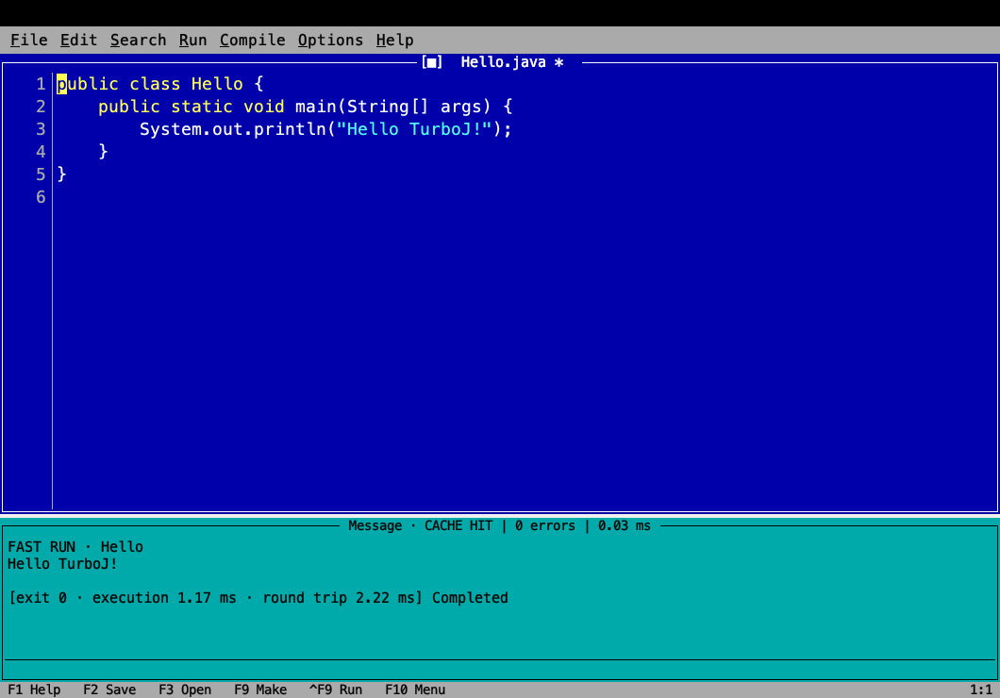

# TurboJ

A small, keyboard-first Java 25 desktop editor for macOS. DOS blue, a source buffer, real compiler diagnostics and one command to run. Swing/Java2D, no browser shell or telemetry.



## Run

```sh
./mvnw package
./turboj
./turboj examples/Hello.java
```

Development requires **JDK 25**; Maven Wrapper downloads pinned Maven/dependencies on the first build into `.cache/`. The packaged desktop includes its runtime and compiler.

The initial buffer is a working Hello World. Press **Ctrl+F9** or **Cmd+R**, change the string, then run again. **F2 / Cmd+S** saves; **F3 / Cmd+O** opens. On macOS, function keys may require Fn. Run works from unsaved buffers. Open **Run → Java REPL** for expressions and declarations without a main method. Enter submits, arrows navigate history and Tab completes. For `Scanner(System.in)`, Run automatically focuses the output pane, with the cursor immediately after the program prompt. Type directly on that same line, for example `Inserisci un numero: 20`, and press Enter. The timeout pauses while the program waits for stdin. **F6** switches between input and source. **Cmd+.** stops a program. Pressing **Cmd+R / Ctrl+F9** again kills the previous program and starts the current buffer with fresh input state.

## Implemented

- A custom Java2D editor backed by a piece table, incremental line index and immutable snapshots; selection, Unicode/UTF-8, CRLF, clipboard, undo/redo, indentation, search, comments, bracket matching and input-method composition.
- Keyboard menus and command palette, three editable JSON themes, font sizes, save protection for external file changes, atomic writes and recoverable buffers.
- Background JDT Java 25 recovery analysis and in-memory javac compilation, version checks, coalescing and bounded successful-source cache. Diagnostics navigate through **Compile → Go to first error**.
- Persistent independent JVM for Fast Run, fresh class loader per run, Isolated Run, streaming stdout/stderr and stdin, timeout, Stop, crash recovery and bounded output. Java 25 compact sources and instance main methods are supported.
- An integrated remote JShell console with multiline submission, history, completion, selection/statement evaluation, Stop/reset, plus standalone `tj` commands; see [CLI documentation](docs/cli.md).
- Unit/integration tests, desktop smoke harness, JMH and end-to-end benchmarks, and macOS packaging scripts.

This is the first usable implementation, not the completion of every planned milestone. Project import, dependency-aware incremental builds, project JUnit execution and the debugger remain open. Read [limitations](docs/limitations.md) before using it on a larger project. Fast Run executes trusted local code and is **not a sandbox**.

## Verify

Tests launch child JVMs and local JShell/JDI sockets. Restricted execution sandboxes must permit those operations; normal local macOS execution was verified. See the [implementation session report](docs/session-2026-10-23.md).

```sh
./scripts/test.sh
./scripts/benchmark.sh
./tj doctor
./tj run examples/Hello.java
./tj eval '1 + 2'
```

The desktop smoke harness exercises new buffer → compile → run → edit → run, actual diagnostics, themes, Stop, stdin and typing during compilation. After building:

```sh
java --enable-native-access=ALL-UNNAMED -cp 'app/target/test-classes:app/target/turboj-app.jar' com.turboj.app.GuiSmoke
```

It opens a real window, emits `app/target/gui-smoke.txt` and paints the frame to `app/target/turboj-smoke.png`. This uses synthetic key events; it does not measure the operating system input queue or display scanout.

## Package

```sh
./scripts/package-macos.sh       # dist/TurboJ.app
./scripts/package-macos.sh dmg path/to/new-output-directory
```

Run packaging on the target architecture. The macOS bundle version is `1.0.2` because jpackage requires a positive first component; this remains the `0.1.0-SNAPSHOT` development preview. `TURBOJ_SKIP_BUILD=1` reuses an already verified application JAR. Builds are for local development, without Developer ID signing or notarization. A bundled `jlink` runtime includes compiler, JShell, desktop and debugger API modules; the worker launches its included `bin/java`.

[Architecture](docs/architecture.md) · [Compiler](docs/compiler.md) · [Performance](docs/performance.md) · [Shortcuts](docs/shortcuts.md) · [Themes](docs/themes.md) · [Worker protocol](worker/docs/protocol.md) · [Licenses](docs/licenses.md)

## Website

The official static website lives in [`website/`](website/README.md), separately from the desktop build. It uses Astro, TypeScript and local assets. Build and browser/accessibility verification instructions are included there. The original screenshot is preserved and the displayed timings describe that single captured run.
