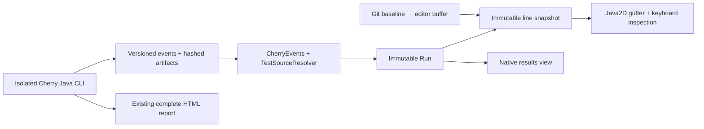

# Cherry Test × TurboJ native integration

Status: **implemented and tested vertical slice; Task 2 is not complete**. Baselines inspected: TurboJ `bb59258`, Cherry Test `0dc649cb`, JUG `b1f1ad8`. Existing example edits and JUG working-tree changes were preserved.

## Ownership and execution

Cherry Test remains the orchestrator. Its Java CLI optionally emits schema-v1 JSONL when `CHERRY_TEST_IDE_EVENTS` is set. Ordinary CLI and HTML reporting remain available. TurboJ does not parse ANSI output or HTML colors as results and adds no test-framework dependency to the editor.



`TurboTestController` owns `CherryTestProcess`. The child CLI owns scheduling, adapters and aggregation. `LineIntelligenceController` handles project discovery, history loading, source identity and asynchronous Git/source projection. Plain projects keep the existing TurboTest execution route.

Normal **Run Java / JUnit** starts the configured Cherry workflow alongside a main-program execution. A test target in a Cherry project takes the Cherry route, avoiding duplicate execution through native JUnit. Explicit native Run Current Test/Class commands retain their original meaning. Fast/Isolated execution internals are unchanged. Cherry runs use saved files; declining Save before Run does not make its disk-based tests validate unsaved buffers.

Feedback is progressive **per adapter phase**, not per individual test start. The existing Cherry scheduler remains authoritative; this change does not add speculative duration-based prioritization. Cancellation terminates the CLI and observed descendants, retains partial evidence and invalidates old callbacks. A terminal success event remains provisional until the CLI exits successfully: a later nonzero exit becomes incomplete, retaining actual individual results. A bounded 64 KiB output pump avoids an unbounded EDT queue; CLI output is also retained beside the event file as `.jsonl.log`.

## Configuration and use

1. Open a source within an existing `cherry-test.yaml`, `.yml` or `.toml` project. The nearest configuration is selected. Detection does not create or rewrite configuration.
2. In the Command Palette, use **Cherry Test: Configure CLI…** and supply the modified Java CLI JAR or a compatible executable/wrapper. A blank preference uses `CHERRY_TEST_JAR`, then `cherry-test` on PATH. The executable must support the new protocol; a legacy/Rust CLI without events cannot provide native results and is reported incomplete.
3. Use **Run Java / JUnit**, or **Cherry Test: Run Configured Suites**. Configure Maven/tool dependencies in the launch environment as the standalone project requires.
4. Use **Inspect Line Intelligence…**, or click any of the three gutter lanes. Arrow keys choose Git, Tests or Coverage; Enter focuses details; Escape restores editing. Quick Fix explicitly navigates to the inspected source line.
5. **Cherry Test: Native Results…**, **Cancel Execution**, and **Open Full Report** remain available through CommandJ. No default keymap or custom shortcut is changed.

The CLI preference is `cherryTestExecutable` in TurboJ settings. JSONL history is under the TurboJ configuration directory, `cherry-runs/<workspace-path-hash>/`. Completed and incomplete prior schema-v1 sessions can be reloaded. A controller-owned `.jsonl.completion.json` receipt binds the observed process outcome to the event SHA-256 and run identity. Reloading cannot turn a rejected success or cancelled execution into success. Missing, malformed or mismatched receipts leave the historical execution incomplete and retain its actual reported evidence. Arbitrary historical HTML/legacy adapter directories are not automatically imported.

Configuration presence is detected passively; full validity is checked by the CLI on execution. Preflight failures that occur before the first event are explicitly incomplete, with captured output. Projects with a mandatory launcher must configure/use that launcher. In particular, JUG validation used its network-isolating `scripts/local-run.sh`, not an unrestricted direct invocation of its full configuration.

## Contract and semantic rules

Cherry's authoritative contract is [`docs/native-ide-events.md`](../../../cherry-test/docs/native-ide-events.md) in the sibling repository. Event kinds are `run.started`, `phase.started`, `phase.completed`, `run.completed`. Each event carries schema version, run ID, sequence and monotonic elapsed time. Phase identity uses the emitted full-manifest key plus adapter/runtime, preserving separate manifests even when display labels match; repeated test names retain distinct occurrence IDs. Legacy controls lacking that key use an unambiguous tuple of their supplied identifiers. Artifact hashes are checked before ingestion.

The immutable Java model separates `TestStatus`, `Freshness`, `CoverageState`, `Availability`, `Precision`, `Attribution`, `SourceIdentity`, `Deletion`, `Snapshot` and `Run`. Unknown counters are `-1`; a measured zero is zero. Disabled, absent, incomplete and excluded data remain distinguishable.

* A failed package or infrastructure failure never creates a failed production-line test. The legacy Java **and Rust** report interpretations were corrected too; aggregate failure remains visible at its real scope.
* Adapter-reported locations remain `REPORTED_TEST_LOCATION` unless their role is explicit. They are not assumed to be production execution edges.
* `TestSourceResolver` resolves exact JUnit class/method identities to direct declarations through JDT, using matching source hashes. Duplicate types, overloads, incomplete/changed inventories, inherited methods, display-name suffixes and unresolved annotations are conservatively left unattributed.
* JaCoCo sidecars preserve `ci`, `mi`, `cb`, `mb`; a positive instruction count alone does not erase missed instructions or branches. Binary LCOV remains binary. Multiple binary collections use union; separate numeric counter sets are not added or treated as identical probes. Ambiguous counter unions become unknown; raw collections remain in the event/artifact evidence.
* An unavailable source hash, a changed buffer, or a different document prevents old line associations from being painted at new positions. Undo does not itself certify compiled identity.
* `.exec` class IDs, compiler-input manifests and instrumented process identities are **not yet transported**. Source-before/after hashes establish stability, not source-to-executed-bytecode identity. Imported measurements and resolved test declarations consequently retain `Freshness.UNKNOWN`; inspection exposes the actual counts/outcomes while current-success/current-coverage colors remain neutral. Synthetic rendering tests exercise fully verified states, but are not evidence that this missing provenance has been implemented.

This conservative policy follows the need for matching runtime and analyzed class identities described in [JaCoCo class IDs](https://www.jacoco.org/jacoco/trunk/doc/classids.html). Instruction and branch counters are distinct measurements; see [JaCoCo counters](https://www.jacoco.org/jacoco/trunk/doc/counters.html).

## Git and revision mapping

`GitBufferDiff` compares the selected baseline blob directly with the captured current buffer. Thus staged, unstaged and unsaved changes are not concatenated or selected in preference order. HEAD is the current UI baseline; the provider API accepts another explicit baseline. Staged renames, new/untracked files, unborn repositories, worktrees and nested repositories are tested. An unstaged move is conservatively a new file unless Git supplies a rename identity.

Deleted text is stored at a **gap**: 0 before the first line, n after line n, including EOF and an empty document. It never receives current test or coverage facts. Ignored, binary, inaccessible and oversized files return a diagnostic, not fabricated additions. CRLF/CR is normalized for physical-line comparison; source fingerprints remain exact, so line-ending normalization cannot certify coverage freshness.

Git runs off the EDT with bounded input/output, interruption and timeout. It does not write the index or working file, and disables repository fsmonitor helpers. Publication checks both document identity and revision; an old project cannot remain launch-eligible during asynchronous detection.

## Rendering and themes

The existing `EditorComponent` gains three narrow cells: Git, Tests, Coverage. Test/coverage space is allocated together for the session. Evidence invalidation and buffer restoration keep geometry stable; explicit context removal collapses it. Only visible real source rows are painted; AI ghost rows do not inherit source facts. Mouse hits, deletion notches and keyboard details are independent of caret placement.

Optional theme roles are `test.success`, `test.failure`, `test.pending`, `test.unknown`, `coverage.covered`, `coverage.uncovered`, `coverage.partial`, `git.added`, `git.deleted`, `status.stale`, `status.unknown` (and compatibility `status.pending`). Legacy themes derive these roles once at load, retaining semantic hue families and at least 4.5:1 contrast against the actual gutter background. Selection/emphasis painting is clipped to the text area and does not replace that background. Shapes convey the meaning independently of color. No 103-theme JSON migration is required.

## Implementation files

| Path | Responsibility |
|---|---|
| `core/src/main/java/dev/turboj/testing/intelligence/LineIntelligence.java` | Immutable domain model |
| `core/src/main/java/dev/turboj/testing/intelligence/CherryEvents.java` | Versioned events, hash checking, precision-preserving normalization |
| `core/src/main/java/dev/turboj/testing/intelligence/TestSourceResolver.java` | Conservative JDT test declaration mapping |
| `core/src/main/java/dev/turboj/testing/intelligence/GitBufferDiff.java` | Baseline-to-buffer comparison |
| `app/src/main/java/dev/turboj/testing/CherryTestProcess.java` | Isolated CLI, cancellation, bounded output |
| `app/src/main/java/dev/turboj/testing/CherryExecutionReceipt.java` | Atomic process-outcome proof for safe history reload |
| `app/src/main/java/dev/turboj/testing/LineIntelligenceController.java` | Asynchronous discovery, revisions and publication |
| `app/src/main/java/dev/turboj/testing/LineIntelligenceDialogs.java` | Native inspection/results surfaces |
| `app/src/main/java/dev/turboj/testing/TurboTestController.java` | Existing controller owns Cherry process lifecycle |
| `app/src/main/java/dev/turboj/app/TurboFrame.java` | Run, commands, focus and project lifecycle |
| `app/src/main/java/dev/turboj/config/Settings.java` | CLI path preference |
| `app/src/main/java/dev/turboj/ui/EditorComponent.java` | Renderer extension and interaction |
| `app/src/main/java/dev/turboj/ui/intelligence/LineGutter.java` | Paint/hit/description model |
| `app/src/main/java/dev/turboj/ui/themes/Theme.java` | Semantic colors and compatibility |

Cherry modifications are in `java/cherry-test-cli` (`NativeEvents`, `CherryTest`, `Runner`, `Builtins`, `Formats`, `DiffView`, `AdapterView`), their regression tests and fixture; the equivalent false-failure interpretation is fixed in Rust `test/cherry-test/src/report/{diff_view,adapter_view}.rs`.

Whole-reactor validation also exposed a pre-existing inconsistency: native contextual `CREATE_CLASS` had entered `Operation`, while external typed CLI/MCP catalogs assumed every enum member had a `Requests` record. `Json.typedOperations()` now supplies the shared supported list, and contextual creation is explicitly rejected there. CLI, MCP and LSP regression coverage verifies this boundary; no new fake Create Class protocol handler was added.

## Reproduction and measured validation

The pinned fixture is [`integration-tests/fixtures/cherry-native`](../../integration-tests/fixtures/cherry-native): Java release 21, JUnit 6.1.3, JaCoCo 0.8.15, compiler plugin 3.16.0 and Surefire 3.6.0. `CherryNativeSmoke` copies it into an isolated temporary project, creates its own Git baseline and invokes real commands through Swing key dispatch. Test setup and caret placement are programmatic; this is not a human/physical-keyboard audit.

```sh
# TurboJ and all native-application dependencies
./mvnw -q -pl app -am verify

# In the Cherry Test repository (JDK 25)
cd ../cherry-test/java
./mvnw -q verify

# Back in TurboJ; Maven must be on PATH for the fixture adapter
java -cp app/target/test-classes:app/target/turboj-app.jar \
  dev.turboj.app.CherryNativeSmoke \
  ../cherry-test/java/cherry-test-cli/target/cherry-test-java.jar
```

The GUI command requires an available macOS desktop. Outputs are in `app/target/cherry-native-smoke`, including report, screenshots, saved source revisions and the native session cache. The driver reactivates its window if another JVM takes host focus; that action is recorded.

**Native walkthrough PASS:** normal Run → actual main output and two passing JUnit tests → independent coverage inspection → unsaved change withholds old line measurements → Save/Run produces one real failure → native failure details → keyboard Undo/Save → complete-suite rerun returns both tests to passing. All three mouse hit regions preserve caret position; keyboard inspection and Escape restore focus. The completed walkthrough and screenshot hashes are in [`native-walkthrough.json`](../evidence/cherry-native/native-walkthrough.json). Earlier controls exposed a run-level-versus-line-level availability bug, which was fixed with a regression test. Driver controls also needed macOS foreground restoration and exact palette selection/awaiting of deferred command execution; those failures are retained locally, not counted as successful runs.

The derived real-execution summary, individual run IDs, source hashes and original artifact hashes are in [`real-executions.json`](../evidence/cherry-native/real-executions.json). It deliberately records separate executions rather than combining their timings into one session.

Real standalone validations retained in the local evidence directories:

| Execution | Observed result | Coverage interpretation |
|---|---|---|
| Two-test Java fixture | 2 pass; deliberate failure control 1 fail/1 pass | Real JaCoCo partial branches and uncovered code; compiled identity unknown |
| Isolated copy of mini Java unit module | 3/3 pass | Real precise JaCoCo sidecar |
| Isolated copy of shop cart | 12/12 pass | Real LCOV; binary precision |
| Isolated shop Java unit subset | 32/33 pass, existing `reports_a_price_mismatch` failure retained | Missing report in first failing control; JaCoCo available when explicitly allowing reporting after test failure |
| JUG shop-domain | 9/9 pass | Configuration disabled coverage |
| JUG shop-spring | 5/5 pass | Coverage disabled; inherited declaration mapping withheld |
| JUG shop-quarkus | 5/5 pass | Separate runtime/package identity, coverage disabled |

JUG used its mandatory local network boundary, synthetic/local fixtures and offline Maven. No production suite or production service was contacted. Entire mini/shop service/browser/Docker matrices have **not** been executed.

All 103 themes passed automated role/contrast checks; raster/hit checks cover sizes 10, 24 and 48, HiDPI, CRLF/Unicode, AI projection and deletion boundaries. The targeted tests also exercise obsolete events, document/project switches, missing protocol, cancellation, child cleanup, partial collections, hash mismatches and overlapping coverage artifacts.

Final validation commands and machine-readable report hashes are in [`automated-validation.json`](../evidence/cherry-native/automated-validation.json):

| Command | Result |
|---|---|
| TurboJ `./mvnw -q verify` | PASS, 721 tests across the full reactor before the final receipt/manifest-identity fixes |
| TurboJ `./mvnw -q -pl app -am verify` | PASS on final code, 690 tests, including 71 new integration-specific regressions; no failures/errors/skips |
| Actual Cherry repository, `java/`: `JAVA_HOME=<JDK25> ./mvnw -q verify` | PASS on final code, 341 tests; no failures/errors/skips |
| Cherry isolated clone: `cargo test -p cherry-test -p cherry-test-core` | PASS, 241 tests; exported source files verified byte-identical to actual repository |
| Cherry isolated clone: `cargo build -p cherry-test` and `cargo fmt --all --check` | PASS |
| `CherryNativeSmoke` using the built application and actual Cherry CLI | PASS after the final fixes, including real passing → failing → passing executions and refreshed final gutter snapshot |
| `git diff --check` in both repositories | PASS |

These runs overlap; their totals must not be added as unique tests. Old XML reports and nested demonstration-project reports are excluded. An earlier sandboxed macOS Swing JVM aborted with exit 134; the full reactor and final application verification passed with desktop access. This was an environment failure, not counted as a successful test run.

Persistent native captures: [editor and neutral provenance indicators](../evidence/cherry-native/native-editor.png), [actual failed-test details](../evidence/cherry-native/native-test-failure.png), and [real partial JaCoCo counters](../evidence/cherry-native/native-coverage-inspection.png). The final screenshot waits for the restored source hash and matching run counters; it does not mistake an empty intermediate snapshot for completed rendering.

Measured offscreen painting without and with dense decorations in the **same build** is in [`paint-and-git-benchmark.json`](../evidence/cherry-native/paint-and-git-benchmark.json). It is not a separate checkout/build of the pre-integration revision. For 100,000 lines the median visible-region paint changed from 290.375 µs to 322.541 µs. Dense snapshot preparation was 17.497 ms and EDT installation 0.029 ms. A 10,000-line Git comparison measured 56.985 ms cold, 42.374 ms warm median and 46.072 ms p95. Negative differences in the smaller paint fixture are warmup/noise, not a claimed speedup. These are **not native input-to-paint or scrolling latency measurements**.

## Remaining acceptance work

| Milestone | Delivery status | Acceptance boundary |
|---|---|---|
| 1 — Normalized data | VERIFIED for the implemented contract | Real events become typed test outcomes and counters; unknown/disabled/missing are distinct. Compilation provenance remains unknown. |
| 2 — Native lanes | VERIFIED for rendering and inspection | Real data is accepted; synthetic verified-state raster tests exercise all colors. Real unproven freshness stays neutral. |
| 3 — Git to buffer | VERIFIED for listed cases | HEAD-to-buffer, staged/unstaged/unsaved, new files, staged renames, gaps and stale-response guards. Other baselines are provider API only. |
| 4 — Native execution | PARTIAL | Full configured run, phase progress, cancellation and report work. Exact individual/failed-test rerun remains incomplete. |
| 5 — High-fidelity coverage | PARTIAL | Actual instruction/branch counters survive ingestion. Exact executing-class/source/process provenance and safe overlapping-process merge remain incomplete. |
| 6 — Full developer workflow | INCOMPLETE | Inspection, known declaration navigation and existing Quick Fix entry work; create-test-to-current-coverage acceptance is not complete. |
| 7 — Scale and compatibility | PARTIAL | Themes, dense offscreen painting, Git timing and representative subsets verified; full service matrices, native latency, memory and large-report validation remain. |

1. Transport compiler/source/class IDs and JaCoCo execution-session/process identity. Until then real imported data does not receive current-code colors. Detect mismatched bytecode explicitly, rather than merely unknown provenance.
2. Exact single-test/failed-test rerun selectors through every adapter; native UI currently offers a clearly labeled complete-suite rerun. No affected-test selection is inferred from aggregate coverage.
3. Per-test progressive starts and complete test inventory, cross-run aggregation policy, and safe inherited contract navigation with classpath/module resolution.
4. Preserve distinct counter collections as independently inspectable native observations, and add provider-level probe merging for overlapping instrumented processes. No numeric-counter summation is used now.
5. Full service/browser/multi-process coverage validation for mini, shop and shop-java; multi-repository configurations outside the selected root; module-specific source/class identity.
6. A full create-test → run → refreshed-current-coverage workflow and a human keyboard walkthrough, plus native input-to-paint/scroll latency and large-report/memory measurements.

The implemented slice is useful for real execution, accurate historical counters, Git and native inspection. It must not be described as the completed seven-milestone testing-intelligence product.
