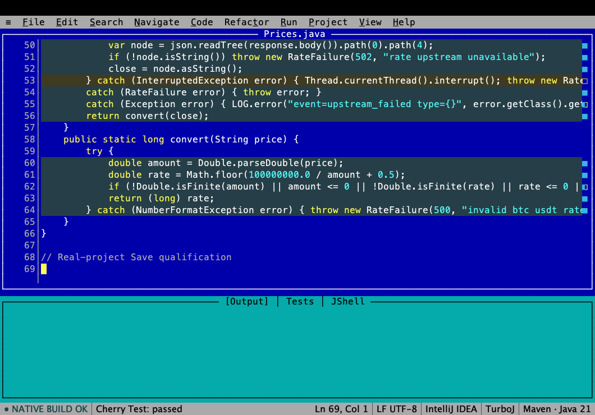

# CH-02/08/09 — implemented pipeline and real-project acceptance

This delivery follows the [earlier qualification](../qualification-2026-11-16/README.md), whose identified implementation gaps are now addressed. It completes the supported Java/JaCoCo provenance path and the requested mini/shop/JUG qualification. It does **not** declare the whole seven-milestone Cherry product complete: exact per-test reruns, additional compiler provenance producers, multi-repository source navigation outside the selected root, and performance work remain separate items in the master TODO.

## Delivered revisions

| Repository | Revision / local delivery |
| --- | --- |
| TurboJ | Changes after `a03254c`; this report is committed with the implementation |
| Cherry Test | `39af874d3d7c3d2589866aed9ee5d7664d47d0df`, integrating native-protocol `302325e8` and sidecars `459c5ed7` |
| mini | `9811e78d94fc40a8af8ad253af748af462be1975` |
| shop-java | `b3429b6896289ccebbcfcb576c493472d6b8daf8` |
| JUG | `8cc859de0264ca4c2f205a7e615bfe84fb543339`; no source change |
| Rust shop | Original sample checkout; its source is retained in the real-artifact archive |

Cherry pins both changed sample gitlinks. Development used isolated worktrees; after testing, the clean original Cherry/sample checkouts were fast-forwarded to these commits. Existing TurboJ examples and JUG AGENTS/ATTIVITA changes were preserved. No production deployment or binary/Maven Central release was performed. CLI/provenance version remains `0.3.16`; pin the commit too.

Environment: macOS 26.5.1 (25F80), arm64, Amazon Corretto 25.0.4.1, Maven 3.9.16, Docker 29.5.3; cached dependencies/images. mini retains Java release 21, Spring Boot 4.1.1 and JaCoCo agent 0.8.14. These are correctness controls, not performance claims. The JUG container image and limits come from its checked-in configuration.

## Implementation

- **TurboJ execution policy:** the new CommandJ action **Cherry Test: Project Execution Mode…** chooses configured/local/container per project. Configured omits the CLI override. Preferences persist; invalid values are discarded. Save and explicit runs use the same policy. No global `--execution local` is imposed.
- **Combined Cherry orchestration:** native events work with the existing dependency/resource scheduler, isolated containers and sidecars. Concurrent writes have a single ordered event sequence. Module/package/runtime identities remain distinct.
- **Server provenance:** external adapters can identify their actual source roots, fresh compiler output and `.exec` directory in `coverage-evidence.json`. The Java CLI recomputes instruction/branch counters from original class bytes and actual probes and validates compiler inputs, class hashes, process/session identities and completion receipts.
- **Probe union:** completed collections with identical source/class identities are merged by JaCoCo probes, never by adding counters. The optional terminal `coverageUnion` artifact replaces otherwise ambiguous overlapping counters. Every contributing compilation and process remains in the proof. An unloaded class in one collection may become provable when another matching collection actually executes it; absence from every execution stays unknown.
- **Cancellation:** TurboJ sends TERM first and allows Cherry's 30-second group cleanup (35-second outer bound) before forcing termination. This happens off the EDT. Observed children are cleaned up; cancelled results remain partial.
- **Samples:** mini and shop-java opt into compiler/process capture only when `CHERRY_TEST_IDE_EVENTS` requests native results. Mini server packaging now honors `skipUnitTests=true`, preventing hidden extra unit execution in a server phase. Shop uses fresh per-invocation output and captures all three JVMs.

## Actual executions

| Control | Observed result | Native semantics |
| --- | --- | --- |
| Primary mini native **Save**, `20261116-151401-101100` | 3 unit + 25 integration + 4 functional + 4 visual = **36 passes** | All five Java source files have verified union evidence: **81 executable lines**. The real editor displayed current coverage after Save; screenshot below. |
| Shop Java integration, `20261116-104931-3857e8` | **12 passes**, three `.exec` sessions/JVMs | **425 current lines**; missing-database probe, occupied-port probe and API process remain identifiable. Some unloaded nested classes remain unknown. |
| Shop Java unit, earlier retained control | **51 passes, 1 failure** | Existing price-mismatch assertion remains failing. No assertion was changed to manufacture success. Report-continuation control and missing-report behavior are in the earlier evidence. |
| Kotlin Spring service, `20261116-112150-c095d8` | **25 integration passes** | Real instruction/branch counters, including partial coverage; no javac proof, therefore UNKNOWN freshness. |
| Rust shop service, `20261116-113054-0d7448` | **12 integration passes** | Real separate-server LLVM/LCOV data, binary precision and UNKNOWN freshness. No invented Java-style proof. |
| Full JUG from native TurboJ command, `20261116-111330-b9b3f0` | **33 phase results, 1,701 passes, 1 skip** | Native results retain Spring/Quarkus, inherited contracts, backend/browser and Vitest package identities. Coverage DISABLED; no uncovered markers fabricated. |
| JUG coverage-requested control, `20261116-121018-fc5b28` | **16 JUnit passes**, plus HTTP observations in full report | Precise counters for 13 contract-helper source files remain UNKNOWN. Backend processes without their own instrumentation do not inherit the test JVM's coverage. |
| Actual native container cancellation, `20261116-153407-7a8920` | **PASS** | Owned containers started, native cancel completed, no labelled container survived, no passing test invented. |

The JUG coverage control temporarily changed only `defaults.coverage` to true, then restored the exact original configuration (`84a1f3070127fc78e43c68cf1573d8a5f7347f0a93c614b92476ec8085c1ef26`). There is no `--coverage` CLI option; the failed attempt is retained. Current application/workspace settings disable coverage by default. This control tests the explicit configuration override, not an imaginary existing enabled parent configuration.

Both mini Save controls restored the original source after capture. Reopening the original source against the captured edited-source report must therefore invalidate that report. `mini-native-save/saved-source.java.gz` is the exact compiler input for the captured Save. A restored file is not silently declared current against a different source hash.



Native acceptance uses actual Swing/application commands and asynchronous results, with programmatic setup. It is **not** the QFX-04 human keyboard-only walkthrough.

## Final standalone-compatibility control

The first sample profile used the capture token as its activation condition. That token is also supplied during standalone Java CLI coverage, so the final sample commits instead activate only on `CHERRY_TEST_IDE_EVENTS`. Actual effective-model checks for both samples prove that a token alone does not add the provenance dependency and native capture does.

- Standalone mini `20261116-165606-8a9170`: **3 unit passes**, ordinary coverage/report generation, native profile inactive.
- Native shop `20261116-165547-b6b170`: **12 integration passes**, **425 verified lines**, all three process/session identities retained.
- Native mini Save `20261116-165832-8c2fb0`: **36 passes**, **81 verified lines / five files**, current evidence painted in the real editor. The acceptance now explicitly fails if no current proven coverage is returned. Its final screenshot and exact saved source are under `mini-native-profile/`.

These are separate compatibility controls, not selected timings spliced into the original runs. `profile-compatibility.rb` and the corresponding logs preserve the model check. No production Java implementation changed after the full TurboJ build; the Save acceptance assertion was strengthened and rerun against that same application JAR.

## JUG report count reconciliation


The earlier CLI summary of 1,719 passes and one skip is not the native execution inventory. Running the report's actual readers against the recorded artifacts shows:

- 1,702 adapter execution records become 1,677 unique report names: the legacy report collapses 25 names across executions.
- 34,643 HTTP observation records group into 90 names. 47 also occur in adapter names; 43 are additional HTTP-check groups.
- `1,702 - 25 + 43 = 1,720` report entries: 1,719 passing and one skipped.

The native stream preserves all 1,702 actual execution identities and does not manufacture 43 additional JUnit tests or line associations from HTTP observations. `ReportCounts.java` and `logs/jug-count-reconciliation.log.gz` reproduce this explanation. The standalone report retains its established aggregation behavior; separate collection presentation and broader report identity changes are not silently folded into this task.

## Automated validation

| Command | Outcome |
| --- | --- |
| TurboJ `./mvnw install` | **PASS, 873 tests in 125 reactor suites**, zero failures/errors/skips; 3m36s. Excludes the two historical tests under `examples/maven/target`. |
| Cherry `./mvnw -pl cherry-test-cli -am spotless:apply install` | **PASS, 393 tests**, two default opt-in Docker skips |
| `CHERRY_TEST_DOCKER_SMOKE=1 ./mvnw -pl cherry-test-cli verify -Dtest=ContainerTest -Dit.test=SidecarSmokeIT` | **PASS**, 13 unit controls plus one sidecar integration control; includes both default-skipped Docker controls |
| Cherry `cargo test -p cherry-test -p cherry-test-core` | **PASS, 317 tests**, two opt-in Docker tests ignored by default |
| Same Cargo command with `-- --ignored` | **PASS**, both real Docker controls |
| shop-java `./mvnw -f tools/shop-adapter/pom.xml test` | **PASS, 7 tests** |
| Native `CherryProjectSaveQualification`, `CherryProjectRunQualification`, `CherryContainerCancellationAcceptance` | **PASS**, actual projects/containers as recorded above |
| `CherryProjectQualification` | **PASS** for real shop Java, mini union, Kotlin, Rust and JUG data; source/bytecode tamper and restoration checks execute on verified captures |
| `KeyboardRegistryAudit docs` | **308 commands, 29 aliases, zero bindings without callbacks** |

New regressions cover serialized parallel events, three process receipts, missing execution data, source/class mismatch, path escapes, actual probe union across two real compilations and complementary branches, unverified union inputs, artifact tampering, terminal-only aggregate publication, cancellation downgrade, preference migration and Save's container override. Existing source-staleness, late-result and project-switch guards remain tested.

## Reproduce locally

```sh
cd /Users/luca/Workspace/cherry-test/java
./mvnw -pl cherry-test-cli -am install
cd /Users/luca/Workspace/turboj
./mvnw install
./tj
```

In TurboJ, choose **Cherry Test: Configure CLI…** and use:
`/Users/luca/Workspace/cherry-test/java/cherry-test-cli/target/cherry-test-java.jar`.
Use **Cherry Test: Project Execution Mode…** → `container` for JUG. `configured` preserves package settings for other projects; the Java mini acceptance resolved to `local` through its configuration/default.

JUG's prescribed parallel mode can be supplied through its CLI launcher (`java -jar … --jobs auto --no-crap "$@"`); the acceptance used such a transparent launcher, with execution mode supplied by TurboJ's actual project preference. Run preparation according to JUG's `scripts/test-prepare.sh` and AGENTS instructions. The test image and prepared dependencies are necessary; do not replace them with an unisolated run.

Reproduction commands for native drivers are their documented `main` arguments in:

- `app/src/test/java/dev/turboj/app/CherryProjectSaveQualification.java`
- `app/src/test/java/dev/turboj/app/CherryProjectRunQualification.java`
- `app/src/test/java/dev/turboj/testing/CherryProjectQualification.java`
- `app/src/test/java/dev/turboj/testing/CherryContainerCancellationAcceptance.java`

Use disposable source copies for Save/tamper controls. Install mini's frozen pnpm dependencies and keep its Rust sibling crates resolvable. Captured configurations are under `configuration/`. Final mini configuration selects Java's four categories; the separate Kotlin control is retained in `mini-with-kotlin.yaml`. Do not run mutation/live-network suites implicitly.

## Evidence and limits

`capture-manifest.json` records original paths and hashes of logs/events/captures. `artifact-hashes.json` indexes the compressed real source/class/probe/receipt artifacts. `validation.json` records final source/build identities and suite counts. `SHA256SUMS` covers delivered files. Raw requests, generated compose credentials, personal settings, dependency caches and application JARs/executables are excluded. Original `.class` and `.exec` evidence is retained. Historical evidence is untouched. Log files include failed controls as well as successful validation.

**Supported and verified:** fresh javac output with JaCoCo, including nested classes where executed, separate server JVMs and cross-phase probe union. Edited sources, changed bytecode, incomplete/cancelled execution, missing capture and incompatible generations fail closed.

**Unsupported provenance producers:** ECJ, Kotlin, Rust/LLVM and arbitrary incremental/reused compiler outputs. Their actual results/counters can be shown as historical/unknown, but cannot be advertised as current. No per-test dynamic production-line attribution is inferred from aggregate probes. These are explicit capability boundaries, not fake passing implementations.

QFX-04 remains the next agreed workflow task. Remaining Cherry product requirements stay in the master TODO; this delivery does not erase them.
